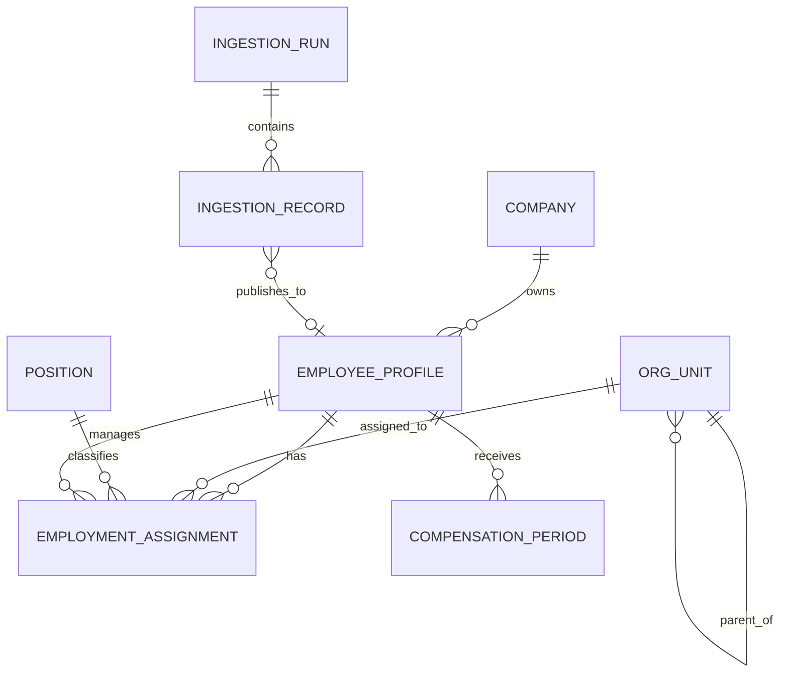

# SharePoint ↔ HR data dictionary — draft v0.1

Last updated: 2026-10-25
Status: logical draft; no phase-B physical migration has been applied

This dictionary turns the sample-data assessment into reviewable domain structures.
Names and fields are proposals until BA authority, retention, permissions, and
effective-date rules are approved.

## Conventions

- Every tenant-owned record carries `company_id`.
- Physical IDs are internal text UUIDs; source codes remain strings.
- `employee_code` is the proposed business key. Preserve the displayed source value
  and derive a separate canonical value for matching.
- Effective-dated records use `effective_from` and nullable `effective_to`.
- Personal, identity, bank, payroll, and tax data require separate field permissions.
- `source_identity_links` records source keys; domain tables do not depend on row
  numbers or mutable sharing URLs.

## Domain relationship

## 1. Employee profile

Grain: one current person/worker profile per `company_id + employee_code`.

| Field | Type | Rule / meaning | Sensitivity | Sample source status |
|---|---|---|---|---|
| `id` | text UUID | Internal immutable key | Internal | Target only |
| `company_id` | text UUID | Required tenant key | Internal | App context |
| `employee_code` | text | Required displayed code; retain leading zeros | Internal | Confirmed |
| `employee_code_canonical` | text | Normalized join key; unique policy pending | Internal | Derived |
| `full_name` | text | Required legal/display name policy pending | Personal | Confirmed |
| `preferred_name` | text nullable | Optional working name | Personal | Needs mapping |
| `date_of_birth` | date nullable | Validate range; restricted view | Personal | Present in wide master; mapping pending |
| `gender_code` | enum nullable | Controlled vocabulary | Personal | Present; catalog pending |
| `work_email` | text nullable | Email validation | Personal | Mapping pending |
| `personal_email` | text nullable | Keep separate from work email | Personal | Mapping pending |
| `phone` | text nullable | Preserve country/leading zero | Personal | Mapping pending |
| `address` | structured/text nullable | Future structured address decision | Personal | Mapping pending |
| `worker_status` | enum | Active/inactive/leave/contractor definitions pending | HR restricted | Confirmed concept |
| `join_date` | date nullable | Company join date authority pending | HR restricted | Current app field |

Identity-document, bank, tax, insurance, and emergency-contact fields must be separate
protected entities or field groups rather than extending a broadly readable employee
row.

## 2. Employment assignment

Grain: one employee assignment for an effective period. This avoids overwriting
history when department, manager, position, grade, location, or status changes.

| Field | Type | Rule / meaning | Sensitivity | Sample source status |
|---|---|---|---|---|
| `id` | text UUID | Internal assignment key | Internal | Target only |
| `company_id` | text UUID | Required tenant key | Internal | App context |
| `employee_id` | text UUID | FK employee profile | Internal | Join by employee code |
| `effective_from` | date | Required for published history | HR restricted | Rule pending |
| `effective_to` | date nullable | Null means current | HR restricted | Target only |
| `employment_type` | enum nullable | Employee/contractor/intern/etc. | HR restricted | Catalog pending |
| `org_unit_id` | text UUID nullable | Department/team assignment | Internal | Confirmed source concept |
| `position_id` | text UUID nullable | Position dictionary reference | Internal | 10 sample rows unresolved/missing |
| `manager_employee_id` | text UUID nullable | Reporting line; cannot self-reference | HR restricted | Mapping pending |
| `branch_id` | text UUID nullable | Work branch/location | Internal | Source catalog available |
| `grade_code` | text nullable | Controlled grade | HR restricted | Source dictionary available |
| `level_code` | text nullable | Controlled level | HR restricted | Source dictionary available |
| `assignment_status` | enum | Draft/active/ended etc. | HR restricted | Definition pending |

## 3. Organization unit

Grain: one versioned department/team/unit node.

| Field | Type | Rule / meaning |
|---|---|---|
| `id`, `company_id` | text UUID | Internal and tenant keys |
| `unit_code` | text | Stable company business code; creation policy pending |
| `name_vi`, `name_en` | text | Vietnamese name required; English optional |
| `unit_type` | enum | Department/team/division/project/etc. |
| `parent_unit_id` | text UUID nullable | Acyclic hierarchy |
| `manager_employee_id` | text UUID nullable | Accountable lead |
| `effective_from`, `effective_to` | date | Preserve org history |
| `status` | enum | Draft/active/inactive |

The narrative/merged org-chart workbook maps here through a dedicated org-design form,
not the generic employee row parser.

## 4. Position and job-title catalog

Grain: one position/job classification per company and effective version.

| Field | Type | Rule / meaning |
|---|---|---|
| `position_code` | text | Stable key; uniqueness within company |
| `title_vi`, `title_en` | text | Bilingual label from controlled catalog |
| `job_family` | text nullable | Functional grouping |
| `grade_code`, `level_code` | text nullable | Controlled references |
| `effective_from`, `effective_to` | date | Version history |
| `status` | enum | Draft/active/inactive |

## 5. Compensation period

Grain: one employee compensation package for an effective period. Restricted from
general employee-directory access.

| Field | Type | Rule / meaning |
|---|---|---|
| `employee_id`, `company_id` | text UUID | Employee and tenant keys |
| `effective_from`, `effective_to` | date | Required history boundary |
| `currency` | ISO currency | Default policy pending |
| `base_salary` | decimal | Non-negative; eight sample assignment rows were missing fixed salary |
| `pay_frequency` | enum | Monthly/hourly/etc. |
| `allowance_total` | decimal nullable | Prefer derived line items in later model |
| `source_record_id` | text UUID | Lineage to approved ingestion record |

## 6. Integration and ingestion control plane

| Entity | Business key / grain | Important fields |
|---|---|---|
| `integration_connections` | app user + company + Microsoft account | owner user, tenant/account IDs, scopes, health, secret reference; no plaintext token |
| `integration_sources` | company + SharePoint drive item/table | site/drive/item IDs, table/sheet, last eTag, mapping version |
| `data_form_versions` | form key + immutable version | JSON schema, field sensitivity, roles, effective date |
| `source_mapping_versions` | source + form + immutable version | header/table strategy, field maps, transforms, lookups |
| `ingestion_runs` | source version execution | eTag/hash, actor, timestamps, counts, status |
| `ingestion_records` | run + source row business key | raw/normalized/proposed payloads, diff, issues, decision |
| `ingestion_approvals` | run/record + reviewer decision | role, decision, reason, timestamp |
| `source_identity_links` | source system + source key | domain entity ID, first/last run IDs |

## 7. Reporting and export control plane

| Entity | Grain | Important fields |
|---|---|---|
| `report_versions` | report key + immutable version | fields, filters, joins, labels, formatting, permission policy |
| `report_destinations` | company + target | site/drive/item/folder, new-file or table/range mode, conflict policy |
| `export_runs` | one execution | data watermark, row count, hash, eTag before/after, actor, status, output link |

## Source-to-domain coverage

| Source area | Target domain | Coverage |
|---|---|---|
| Active/inactive employee sheets | Employee profile + worker status | Profile pilot partly implemented; authority rule pending |
| Job assignment `Database` | Assignment, position, org unit, compensation | Parser understands core fields; full canonical persistence pending |
| Job/department/team/branch dictionaries | Controlled catalogs | Reused in Excel wizard; database catalogs pending |
| Org-chart narrative sheets | Org unit, reporting line, responsibility | Dedicated mapping/form not started |

## Review gates before physical schema

1. Approve business keys and code reuse policy.
2. Approve source authority and conflict rules per field family.
3. Approve roles and retention for sensitive groups.
4. Confirm effective-date behavior and correction/backdating rules.
5. Convert logical names into migration-ready Postgres tables, constraints, indexes,
   RLS policies, and transactional publish RPC.
