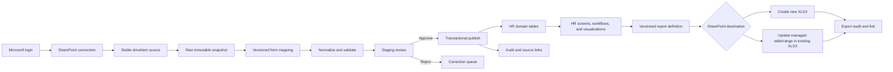

# SharePoint ↔ HR data pipeline architecture

## Goal

Let each company connect a Microsoft 365 account, select SharePoint data, map it
to a versioned HR input form, validate it, review changes, and publish approved
records into HR. Users then work with, visualize, and enrich the canonical data in
the HR app. Versioned report definitions export that app data back to a new or
existing XLSX file on SharePoint. Source workbook layouts are examples, not a
permanent API.

The HR app is the **system of work** and the authority for approved operational
state. SharePoint is an inbound source and an outbound reporting destination. An
export is always generated from approved app data, never passed directly from an
unreviewed source snapshot.

The first pilot is an interactive pull initiated by a signed-in user. Scheduled
background synchronization is a later mode because it needs a server-side token
broker and durable encrypted credentials.

## What the current source files show

The three reviewed workbooks represent different data grains:

| Source | Useful grain | Observed structure | Pipeline treatment |
|---|---|---|---|
| `DS_MIDOMAX 2026_Master.xlsx` | One row per employee or contractor | Multiple active/inactive sheets, title rows before headers, 100+ columns, employee codes displayed with leading zeros | Employee master form; source status decides active/inactive scope |
| `Job_Titles_VI_EN.xlsx` | Employee assignment plus job/department dictionaries | `Database` joins employee code to position, grade, level, team, department, and compensation; other sheets are reference dictionaries | Employment assignment, position, org-unit, and compensation forms |
| `Orgchart_ProductDev&Sourcing_v2 20260921.xlsx` | Organization design and responsibilities | Merged cells and narrative blocks rather than stable records | Dedicated org-design form or manual mapping; never treat as employee rows |

Profiling on 2026-10-25 found 209 active employee rows and 215 assignment rows.
After normalizing leading zeros, 203 employee codes matched. The employee master
had 6 codes without an assignment; the assignment file had 10 codes outside the
active master and 2 duplicated normalized codes. Ten assignment rows lacked a
position and eight lacked fixed salary. These are review conditions, not reasons
to silently discard records.

The existing `employees` table only covers code, name, department, base salary,
status, and join date. Identity, contact, bank, compensation history, job grade,
team, reporting line, and organization design need separate governed models.

## Target flow

1. **Connect** — Microsoft login grants the least delegated scope needed to read
   the selected content. Resolve a sharing URL once, then retain stable SharePoint
   site/drive/item identifiers rather than depending on a mutable sharing link.
2. **Snapshot** — download a file version and record its item ID, eTag, hash,
   modified time, source account, and form version. Raw payload is immutable and
   retention-limited.
3. **Map** — a company administrator maps a sheet/table and source columns to a
   published form version. Column names and sheet names stay in configuration.
4. **Validate** — preserve identifiers as strings, normalize dates and controlled
   vocabularies, run required/unique/reference/business rules, and compare the
   proposed change with current HR data.
5. **Review** — show inserts, updates, deactivations, unchanged rows, warnings,
   and blocked rows. A file can never deactivate missing employees by default.
6. **Publish** — a server-side transaction/upsert applies approved rows under
   `company_id` and records exact source lineage. Retrying the same eTag/form
   version is idempotent.
7. **Operate** — existing and future HR modules use the canonical records for
   employee directory, organization, shifts, attendance, leave, payroll, KPI/OKR,
   approvals, and visual analysis. Changes made in the app are audited as normal
   HR changes and do not mutate the inbound snapshot.
8. **Report** — a report definition queries approved app data, produces a reviewed
   dataset, renders XLSX, and publishes it to a configured SharePoint destination.

## App experience

The pipeline should appear as one workflow inside HR rather than a separate
technical console:

1. **Nguồn dữ liệu** — connection health, selected file/table, last change, last
   successful pull, and the form/mapping version in use.
2. **Hộp thư dữ liệu** — pending runs with summary counts and clear states:
   new, changed, deactivated, unchanged, warning, blocked.
3. **Đối chiếu** — side-by-side source/current/proposed values, filters, bulk
   decisions, row detail, and validation guidance.
4. **Phê duyệt & áp dụng** — role-aware approval and a transactional publish.
5. **HR workspace** — canonical data shown through the existing employee,
   organization, shift, attendance, leave, payroll, and performance features.
6. **Báo cáo SharePoint** — select a saved report, preview rows/columns, choose a
   destination, export now, and inspect export history/link.

New HR screens should consume the same canonical domain services as current
screens. Pipeline staging data must not leak into payroll, headcount, or KPI views
before approval.

## Versioned input forms

A form definition is a published data contract, not only a visual form. Each
version defines:

- entity type and business key, such as `employee.employee_code`;
- fields, data types, labels, required rules, formats, allowed values, and default
  values;
- sensitivity classification such as normal, personal, payroll, bank, or identity;
- references to departments, positions, managers, branches, and other forms;
- allowed transformations selected from a safe library (trim, date parse, code
  padding, enum mapping, lookup, numeric/currency parse);
- insert/update/deactivate policy and which roles may review or publish;
- effective date and immutable version number.

Draft forms can change freely. A published form is immutable; modifications create
a new version. Every ingestion run points to the exact form and mapping version.

Suggested first form families:

1. Employee identity/profile.
2. Employment assignment and status.
3. Organization unit and reporting line.
4. Position, grade, and bilingual job-title dictionary.
5. Compensation, bank, tax, insurance, and benefits with stricter permissions.
6. Organization design/PIC responsibility for sources such as the org-chart file.

## Logical storage model

The names below are architectural; create migrations only after the form scope is
approved.

| Model | Purpose |
|---|---|
| `integration_connections` | Tenant-scoped Microsoft connection metadata and health; no plaintext access token |
| `integration_sources` | Stable site/drive/item/table identity, selected connection, refresh policy, last eTag |
| `data_form_definitions` / `data_form_versions` | Draft and immutable published JSON schemas plus permissions |
| `source_mappings` / `source_mapping_versions` | Sheet/table selection, header strategy, field mapping, transforms, lookup rules |
| `ingestion_runs` | One source snapshot execution with counts, hash, eTag, actor, timestamps, and status |
| `ingestion_records` | Row key, restricted raw payload, normalized payload, diff, validation result, and decision |
| `ingestion_approvals` | Reviewer decision and reason; supports separation of duties for sensitive forms |
| `source_identity_links` | External source key → HR entity ID for repeatable updates and lineage |
| `report_definitions` / `report_versions` | Immutable selected fields, filters, joins, labels, ordering, formatting, and permission policy |
| `report_destinations` | Tenant-scoped SharePoint drive/item/folder plus output mode, table/range target, and conflict policy |
| `export_runs` | Report and destination versions, app-data watermark, row count, content hash, eTag before/after, actor, status, and output link |

All tables carry `company_id`, use RLS, and index tenant plus source/status keys.
Raw personal data must have a short retention period and must never be written to
application logs or client error tracking.

## Authentication modes

### App identity versus Microsoft integration

Supabase Auth remains the authority for signing into HR, company membership, and app
roles. Microsoft sign-in is a separately managed SharePoint connection used only while
importing or exporting data. A Microsoft account, email address, domain, tenant ID, or
Graph token must never grant HR-company access by itself.

For the pilot, each authorized HR user connects their own Microsoft account. The
connection is scoped to both `company_id` and the app user's ID, and Graph operations
run with that Microsoft user's delegated permissions. The UI exposes **Connect
Microsoft**, the connected account, connection health, **Reconnect**, and **Disconnect**.
When no valid connection exists, import/export prompts for Microsoft sign-in inline.

AppForYou owns one multitenant Entra application configured for accounts in any
organizational directory. The browser uses the Microsoft `organizations` authority,
which resolves each user's home tenant during sign-in. Customer users never create an
app registration, enter a Client ID, or share a password with HR. A customer tenant's
consent policy remains authoritative; direct SharePoint access cannot bypass a policy
that requires administrator approval. Local workbook upload/download is therefore a
first-class route that guarantees the HR workflow remains usable without customer IT.

Company administrators configure approved SharePoint sources and report destinations;
operators can use only destinations allowed by their HR role and only when their own
Microsoft account can access the underlying SharePoint content. Interactive tokens stay
in the browser session during the pilot. Persistent background synchronization is a
later server-side capability and must not reuse or share one user's browser token.

### Interactive pilot

- SPA authorization code flow with PKCE through MSAL Browser.
- Delegated Microsoft Graph `Files.Read` for import. Request `Files.ReadWrite`
  through progressive consent only when the user enables SharePoint export.
- Token held in browser `sessionStorage` and used only while the user is present.
- Good for selecting a file, previewing, and manually importing.

### Scheduled pipeline

Browser-only login cannot reliably run after the user closes the browser. A future
scheduled mode needs one of these explicit connection policies:

- **Delegated connection:** server-side authorization-code flow, encrypted MSAL
  token cache, tenant revocation controls, and a named connection owner.
- **Application connection:** tenant administrator grants an app certificate access
  to selected sites. This is more reliable for unattended jobs and should use
  SharePoint selected-site permissions rather than tenant-wide read access.

Connection secrets belong in a managed secret store. Supabase tables keep only a
secret reference and non-sensitive connection metadata.

## XLSX output modes

### Create a new report file

Generate a complete XLSX artifact from a versioned report definition and upload it
to a selected SharePoint folder. The filename can use controlled tokens such as
report name, company, period, and export timestamp. If the same deterministic name
exists, the destination policy decides whether to create a versioned name or replace
only when the expected eTag still matches.

This mode is best for month-end snapshots, audit packs, payroll reports, and files
that other teams consume without editing.

### Update an existing workbook

An existing workbook must declare a managed destination, preferably an **Excel
Table** or named range. Use Microsoft Graph's Excel workbook API to open a workbook
session and update only that table/range. This preserves unrelated sheets, formulas,
charts, formatting, and manual notes. The pipeline must not replace the whole file
unless the destination was explicitly configured for full replacement.

Before writing:

1. verify drive item ID, workbook eTag, expected table/range, and report version;
2. render and preview the exact outbound rows in HR;
3. validate headers and table capacity/shape;
4. update within a workbook session;
5. read back row count/key cells and record the resulting eTag/link.

If another user changes the workbook after preview, stop with a conflict and ask the
user to refresh; never overwrite a newer version silently.

Input and output should normally use separate files. If a workbook serves both,
the output must use a dedicated managed table/sheet excluded from inbound mappings,
preventing import/export feedback loops.

## Reliability and safety rules

- Preserve codes such as `00001` as strings; define a separate canonical key for
  joins because another source may expose the same code as `1`.
- Detect duplicate canonical keys before publish. Do not pick an arbitrary row.
- Use drive item eTag plus content hash and mapping version as the run idempotency
  boundary.
- Never infer deletion from a missing row. Deactivation requires an explicit source
  status or a reviewed reconciliation action.
- Treat compensation and bank/identity fields as separate protected forms.
- Show join coverage and unresolved lookup values before approval.
- Publish through a transaction/RPC so a failed run does not leave a partial batch.
- Keep raw, normalized, approved, and rejected states distinct for auditability.
- Keep report definitions and destinations versioned separately so a mapping change
  cannot silently alter a regulatory or management report.
- Apply field-level report permissions before rendering; an XLSX export must never
  expose salary, bank, tax, identity, or personal fields merely because the source
  connection can read them.
- Record an app-data watermark or effective date in each export, so viewers know
  what data state the workbook represents.
- Webhooks or Graph delta checks may trigger discovery; workers still verify eTag
  and obtain an exclusive lock before processing.

## Delivery phases

### A. Interactive connector pilot

Microsoft login, sharing-link resolution, workbook inspection, sheet choice, preview,
and guarded import of the current core employee fields. This validates connectivity
and UX; it is not the final form engine.

### B. Configurable forms and staging

Build form/version management, mapping UI, raw snapshots, row-level validation,
diff preview, approval, idempotent transactional publish, and audit history. Start
with employee master and employment assignment.

Add the first report-definition builder and **create new XLSX** destination after
canonical employee/assignment data is usable in the app.

### C. Scheduled synchronization

Add the approved server-side authentication policy, source health, eTag/delta based
polling, retry/dead-letter handling, notifications, and connection revocation.

Add scheduled exports and safe **update existing Excel Table/range** destinations,
including eTag conflict handling and read-back verification.

### D. Rich HR domain

Add normalized org units, positions/grades, reporting lines, effective-dated
assignments, compensation history, and a dedicated org-design form. Migrate only
approved fields from staging into these models.

## Decisions needed before phase B migrations

- Which form is the authority for employee status, department, position, manager,
  and salary when sources disagree?
- Is employee code immutable and unique across the company, or can it be reused?
- Which roles may view, map, approve, and publish personal/payroll/identity fields?
- Should one approval cover a run, or must sensitive field groups have separate
  reviewers?
- Required raw snapshot retention and audit retention periods.
- Whether scheduled synchronization must continue after the connection owner leaves.
- Which reports may create files, replace managed files, or update existing tables;
  required filename/period conventions and SharePoint folder ownership.
- Whether output workbooks are snapshots or living reports, and which manual columns
  or sheets must be preserved during refresh.
