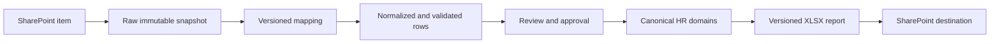

# Trung tâm dự án dữ liệu SharePoint ↔ HR

Last updated: 2026-10-25

Đây là trang bắt đầu dành cho Product/Project, BA, DA, DE và các session/agent mới.
Trang này trả lời ba câu hỏi: **đang làm gì, dữ liệu cho thấy gì, và phải đọc tài liệu
nào tiếp theo**. Không ghi token, thông tin nhận dạng cá nhân hoặc dữ liệu nhân viên
chi tiết vào tài liệu dự án.

## Đọc theo vai trò

| Vai trò | Nội dung cần xem | Tài liệu chính |
|---|---|---|
| Sponsor / Product / Project | Mục tiêu, phạm vi, quyết định, tiến độ, rủi ro, điều kiện nghiệm thu | `CURRENT_STATUS.md`, `SHAREPOINT-PILOT-PLAN.md`, trang này |
| Business Analyst | Người dùng, luồng nhập–đối chiếu–phê duyệt–xuất, quy tắc nghiệp vụ, câu hỏi cần chốt | `SHAREPOINT-INGESTION-ARCHITECTURE.md` mục App experience/Reliability/Decisions; trang này |
| Data Analyst | Nguồn, grain, chất lượng, độ phủ join, thiếu/trùng, định nghĩa chỉ tiêu kiểm soát | Trang này mục Kết quả phân tích; `SHAREPOINT-DATA-DICTIONARY.md` |
| Data Engineer | Pipeline, snapshot, mapping/version, staging, idempotency, lineage, mô hình logic, RLS | `SHAREPOINT-INGESTION-ARCHITECTURE.md`, `SHAREPOINT-DATA-DICTIONARY.md`, `DATA-MODEL.md` |
| Frontend / UX | Hành trình thao tác, trạng thái lỗi, kết nối Microsoft, file wizard | `SHAREPOINT-PILOT-PLAN.md`, `docs/templates/README.md`, `UI-UX.md` |
| Operations / Tester | Cách chạy, cấu hình, URL local/preview và test case còn thiếu | `RUNBOOK.md`, `CURRENT_STATUS.md`, `SHAREPOINT-PILOT-PLAN.md` |

The app-first customer demo and the shared operating model for device upload versus
SharePoint are tracked in `HR-DATA-OPERATING-PLAN.md`.

## Góc nhìn Project

### Mục tiêu

Biến HR app thành nơi người dùng kiểm tra, thao tác và phê duyệt dữ liệu nhân sự. Dữ
liệu có thể lấy từ SharePoint bằng thao tác đơn giản, sau đó xuất báo cáo XLSX trở lại
SharePoint. Layout Excel nguồn được cấu hình theo phiên bản, không hard-code theo một
file mẫu.

### Phạm vi hiện tại

- Pilot local/preview: kết nối Microsoft theo từng người dùng HR và công ty, đọc file,
  nhận diện sheet/header, xem trước lỗi và nhập trường nhân viên lõi.
- Form Excel phase A: hai bảng hồ sơ và phân công công việc, validation chặt, trang kiểm
  tra chất lượng.
- Chưa thuộc pilot: đồng bộ nền, schema staging hoàn chỉnh, phê duyệt nhiều cấp, ghi
  ngược SharePoint và production release.

### Quyết định đã chốt

- Supabase Auth quản lý đăng nhập app, vai trò và `company_id`.
- Microsoft chỉ là integration để import/export SharePoint.
- Kết nối pilot thuộc một cặp `app_user_id + company_id`; không chia sẻ browser token.
- HR là system of work cho dữ liệu đã phê duyệt; snapshot nguồn không đi thẳng vào báo
  cáo nghiệp vụ.
- Làm và test local trước; chỉ đẩy Git theo mốc lớn có thể review.

### Mốc nghiệm thu pilot

1. Một user HR hợp lệ kết nối được tài khoản Microsoft của chính họ.
2. User đọc được file test đã được SharePoint cấp quyền, xem sheet và lỗi theo dòng.
3. Dòng hợp lệ vào đúng công ty; dữ liệu lỗi hoặc trùng không được nhập âm thầm.
4. Desktop và iPhone đều thao tác được.
5. Có audit tối thiểu về file, user, công ty, thời điểm và kết quả; pilot browser hiện
   mới đáp ứng một phần và cần phase B để lưu bền vững.

## Góc nhìn BA

### Tác nhân

| Tác nhân | Trách nhiệm |
|---|---|
| HR Operator | Kết nối Microsoft cá nhân, chọn nguồn, xem lỗi, chuẩn bị dữ liệu |
| HR Reviewer | Đối chiếu nguồn với dữ liệu hiện hành, xử lý cảnh báo và quyết định |
| HR Approver | Phê duyệt việc áp dụng dữ liệu nhạy cảm hoặc thay đổi lớn |
| Company Admin | Quản lý thành viên HR, nguồn SharePoint được phép, form/mapping và nơi xuất |
| System | Chụp snapshot, validate, chống nhập lặp, ghi lineage và chặn truy cập sai tenant |

### Luồng nghiệp vụ mục tiêu

`Kết nối → Chọn nguồn → Snapshot → Map → Validate → Đối chiếu → Phê duyệt → Áp dụng
→ Thao tác trên HR → Xem trước báo cáo → Xuất SharePoint`

### Quy tắc trọng yếu

- Không tự vô hiệu hóa nhân viên chỉ vì một file mới không còn dòng đó.
- Mã nhân viên luôn đọc như text; `00001` và `1` cần canonical key để đối chiếu nhưng
  vẫn giữ giá trị hiển thị gốc.
- Trùng business key là lỗi cần người dùng xử lý; hệ thống không tự chọn một dòng.
- Lương, ngân hàng, thuế, bảo hiểm và giấy tờ định danh là nhóm dữ liệu riêng có quyền
  chặt hơn.
- Ghi vào file có sẵn chỉ được cập nhật Excel Table/named range đã khai báo; không ghi
  đè sheet hoặc nội dung thủ công khác.

### Câu hỏi BA còn phải chốt

- Nguồn nào là authority cho trạng thái, phòng ban, chức danh, quản lý và lương khi
  các file mâu thuẫn?
- Mã nhân viên có được tái sử dụng không và có duy nhất toàn công ty không?
- Ai được map, review, approve và publish từng nhóm dữ liệu nhạy cảm?
- Một lần duyệt cho cả batch hay duyệt riêng compensation/identity?
- Snapshot thô và audit phải lưu bao lâu?

## Góc nhìn DA — kết quả phân tích mẫu

| Nguồn | Grain hữu ích | Kết quả chính | Hành động dữ liệu |
|---|---|---|---|
| `DS_MIDOMAX 2026_Master.xlsx` | Một dòng cho một nhân viên/CTV trong từng tập trạng thái | 209 dòng active được nhận diện; nhiều sheet, header không nằm dòng đầu, hơn 100 cột, mã có leading zero | Tách employee profile khỏi các nhóm nhạy cảm; giữ mã dạng text |
| `Job_Titles_VI_EN.xlsx` | Một dòng phân công nhân viên–vị trí | 215 dòng parser-valid; 10 thiếu position, 8 thiếu fixed salary | Tách assignment, position catalog, org unit và compensation |
| `Orgchart_ProductDev&Sourcing_v2 20260921.xlsx` | Thiết kế tổ chức và trách nhiệm | Merge/narrative layout, không phải row table ổn định | Dùng form org-design riêng; không import như danh sách nhân viên |

### Đối chiếu liên nguồn

- 203 mã nhân viên khớp sau khi chuẩn hóa leading zero.
- 6 mã active master không có assignment.
- 10 mã assignment nằm ngoài active master.
- 2 mã canonical bị trùng trong assignment.
- Kết quả trên là baseline từ snapshot mẫu ngày 2026-10-25; phải chạy lại khi phiên
  bản nguồn trên SharePoint thay đổi.

### Kiểm soát chất lượng cần theo dõi

- Tổng dòng, dòng hợp lệ, dòng cảnh báo, dòng bị chặn theo nguồn và phiên bản.
- Tỷ lệ mã khớp giữa profile và assignment.
- Trùng business key, thiếu trường bắt buộc, reference không resolve.
- Tỷ lệ thay đổi insert/update/deactivate/unchanged trước khi publish.
- Freshness, eTag/content hash và thời điểm snapshot.

## Góc nhìn DE

### Lớp dữ liệu

1. **Connection/source metadata** — connection owner, tenant/site/drive/item, health,
   scope; không chứa plaintext token.
2. **Raw snapshot** — file identity, eTag, hash, modified time, retention policy.
3. **Contract/mapping** — versioned form schema, source column mapping, transforms.
4. **Staging/review** — raw row, normalized row, errors, diff, decision.
5. **Canonical HR** — employee, assignment, org unit, position, reporting line,
   compensation theo effective date.
6. **Reporting/export** — versioned report, destination, export run, eTag và output link.

Mọi bảng tenant phải có `company_id`, RLS và index theo company cộng business/status
key. Retry sử dụng `source item + eTag/hash + form version` làm idempotency boundary.
Chi tiết model và field draft nằm trong `SHAREPOINT-DATA-DICTIONARY.md`.

## Bản đồ artifact

| Artifact | Mục đích | Trạng thái |
|---|---|---|
| `CURRENT_STATUS.md` | Handoff nhanh, yêu cầu mới nhất, blocker và next action | Đang duy trì local |
| `SHAREPOINT-PILOT-PLAN.md` | Checklist và tiến độ theo workstream | Đang duy trì local |
| `SHAREPOINT-INGESTION-ARCHITECTURE.md` | Kiến trúc end-to-end và quyết định kỹ thuật | Draft đã có |
| `SHAREPOINT-DATA-DICTIONARY.md` | Entity/field/key/sensitivity/source draft | Draft v0.1 |
| `docs/templates/HR_Input_Wizard_v1.xlsx` | Form nhập phase A cho user | Đã tạo và kiểm tra cấu trúc |
| `docs/templates/README.md` | Hướng dẫn sử dụng/tái tạo file Excel | Đã có |
| `RUNBOOK.md` | Cấu hình và vận hành local/preview | Đã có; E2E Microsoft còn chặn bởi Entra config |
